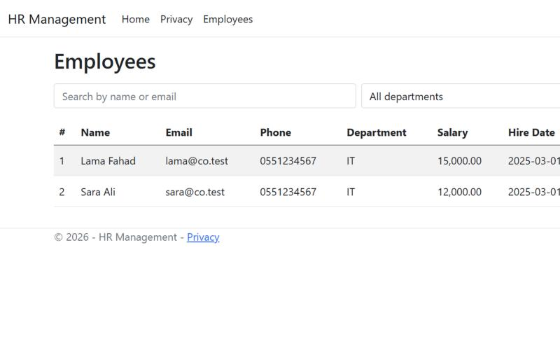
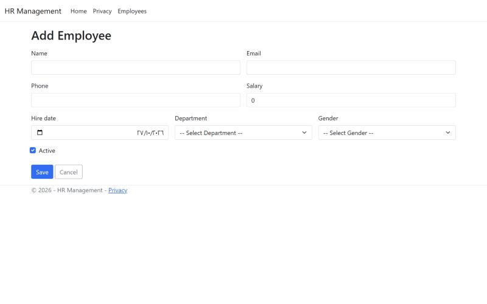

# HR Employee Management

<div dir="rtl">

نظام بسيط لإدارة الموظفين: إضافة، عرض، تعديل وحذف الموظفين مع القسم والجنس والراتب وتاريخ التعيين، وبحث وتصفية حسب القسم.

</div>

A small HR application built with ASP.NET Core MVC and Entity Framework Core: manage employees with their department, gender, salary, hire date and status, with search and department filtering.


| Employees | Add employee |
|---|---|
|  |  |

## Features

- Employee list with search (name or email) and department filter.
- Add, view, edit and delete employees with server- and client-side validation.
- Department and gender lookups (seeded on first run); unique email per employee.
- Data model with relationships: `Employee` → `Department`, `Employee` → `Gender`.

## Run it

Requirements: .NET 8 SDK and SQL Server LocalDB.

```bash
cd renad.net
dotnet run
```

The database and lookup data are created automatically (EF Core migrations).

## What changed from the original practice project

- The "Create employee" page was a copied Bootstrap sample form (email/password/checkbox) with no employee fields, so no employee could be added. It is now a real form with department and gender drop-downs.
- Added edit, details and delete pages, search and filtering.
- Seeded departments and genders; added unique-email validation.
- The connection string pointed to a machine-specific server; it now uses LocalDB.
- Migrations were squashed into one clean `InitialCreate`, and the database is migrated on startup.

## Author

**Renad Madi** — [GitHub](https://github.com/RENAD-MADI)
